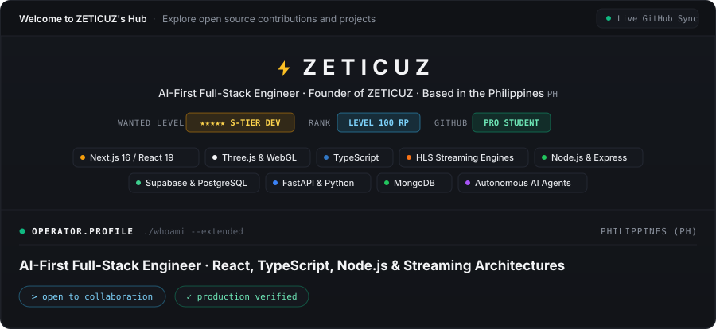
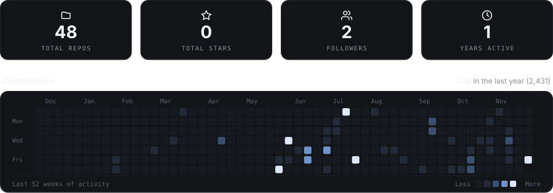
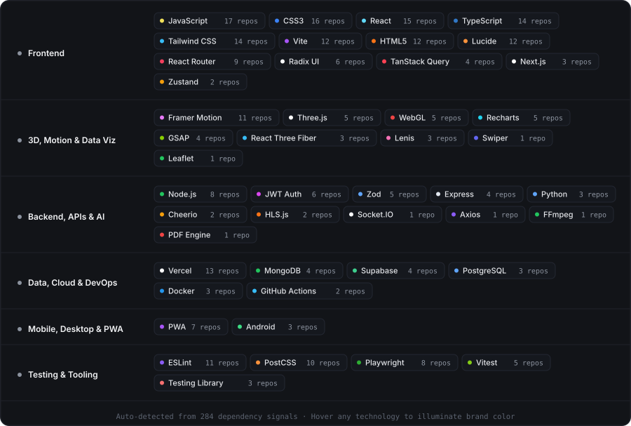
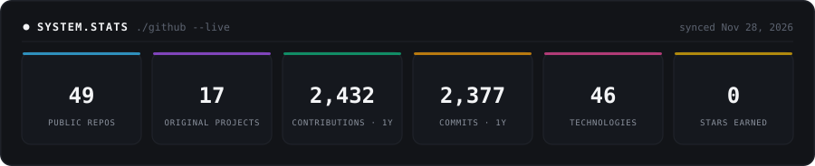

  <!-- Header Description: ⚡ ZETICUZ | AI-First Full-Stack Engineer · Founder of ZETICUZ · Based in the Philippines PH | S-TIER DEV | LEVEL 100 RP | PRO STUDENT | OPERATOR.PROFILE -->
  

 

<!-- Top 4 KPI Cards (Hover Color Reactive) + 52-Week Contributions Heatmap -->

  

### `</>` Tech Stack & Languages

  

### Full-Stack Engineering Spectrum

  

### GitHub System Analytics

  

### Featured Projects & Operations

  

