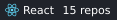
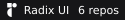
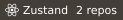
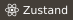

  

  <h1>⚡ Z E T I C U Z</h1>
  
<strong>AI-First Full-Stack Engineer · Founder of ZETICUZ · Based in the Philippines 🇵🇭</strong>

  

    
    
    
  

  

    <code>⚡ Next.js 16 / React 19</code> &nbsp;
    <code>🕹️ Three.js &amp; WebGL</code> &nbsp;
    <code>⚛️ TypeScript</code> &nbsp;
    <code>🎬 HLS Streaming Engines</code> &nbsp;
    <code>🚀 Node.js &amp; Express</code> &nbsp;
    <code>🐍 FastAPI &amp; Python</code> &nbsp;
    <code>🍃 MongoDB</code> &nbsp;
    <code>🤖 Autonomous AI Agents</code>
  

 

<!-- ================= FUTURISTIC ANIMATED ABOUT ================= -->

  

<!-- ================= LANGUAGE STACK (auto-generated by scripts/sync-profile.mjs) ================= -->

  

 

<!-- ================= TECH STACK (auto-detected from every repo's dependency manifests) ================= -->

  <h2>🛠️ Full-Stack Engineering Spectrum</h2>

<!-- TECH-STACK:START -->
<table width="100%">
<tr><td width="24%" valign="middle"><b>🎨 Frontend</b></td><td>
  
  
  
  
  
  
  
  
  
  
  
  
  
</td></tr>
<tr><td width="24%" valign="middle"><b>🕹️ 3D, Motion &amp; Data Viz</b></td><td>
  
  
  
  
  
  
  
  
  
</td></tr>
<tr><td width="24%" valign="middle"><b>⚙️ Backend, APIs &amp; AI</b></td><td>
  
  
  
  
  
  
  
  
  
  
  
</td></tr>
<tr><td width="24%" valign="middle"><b>☁️ Data, Cloud &amp; DevOps</b></td><td>
  
  
  
  
  
  
</td></tr>
<tr><td width="24%" valign="middle"><b>📱 Mobile, Desktop &amp; PWA</b></td><td>
  
  
</td></tr>
<tr><td width="24%" valign="middle"><b>🧪 Testing &amp; Tooling</b></td><td>
  
  
  
  
  
</td></tr>
</table>

Auto-detected from <b>19</b> dependency manifests across <b>17</b> original repositories · badge = number of repos using it · last sync Nov 27, 2026

<!-- TECH-STACK:END -->

 

<!-- ================= GITHUB STATS (auto-generated) ================= -->

  <h2>📊 GitHub System Analytics</h2>

  

 

<!-- ================= MOST RECENT PROJECTS (auto-generated, newest push first) ================= -->

  <h2>🚀 Featured Projects &amp; Operations</h2>

  

 

<!-- ================= FLAGSHIP PROJECTS (curated in profile.config.json, sorted by latest push) ================= -->

  <h2>⚡ Flagship Architectures</h2>

<!-- FLAGSHIP:START -->
<table width="100%">
<tr>
<td width="50%" valign="top">
 <h3>🌿 <a href="https://github.com/ZETIC7Z/el-farm-cafe-and-restaurant">el-farm-cafe-and-restaurant</a></h3>

EL Farm Café &amp; Resto — High-performance farm dining &amp; retreat sanctuary web experience with embedded Supabase Cloud POS, real-time KDS, Three.js 3D carousel, and offline PWA.

     

Updated Nov 27, 2026
</td>
<td width="50%" valign="top">
<h3>🏛️ <a href="https://github.com/ZETIC7Z/Barangay-Online-E-Governance-Portal">Barangay-Online-E-Governance-Portal</a></h3>

Barangay Online E-Governance Portal - Official Smart 3D E-Governance System for Barangay Matatag, Lamitan City, Basilan (BARMM 7302). Built by Sam Pangilinan (ZETICUZ).

     

Updated Oct 29, 2026
</td>
</tr>
<tr>
<td width="50%" valign="top">
<h3>🎫 <a href="https://github.com/ZETIC7Z/CLIENT-QMS">CLIENT-QMS</a></h3>

DSWD AICS Smart Queue Management System with Realtime Multi-Step Workflow, DeepEval-style Analytics, Brownout-Proof Persistence, and Broadcast TV Monitors by ZETICUZ

     

Updated Oct 21, 2026
</td>
<td width="50%" valign="top">
<h3>📋 <a href="https://github.com/ZETIC7Z/CareerForm">CareerForm</a></h3>

CareerForm PH - Free CSC Personal Data Sheet (CS Form 212, Revised 2026) Builder &amp; Government Jobs Portal

     

Updated Sep 26, 2026
</td>
</tr>
<tr>
<td width="50%" valign="top">
<h3>🎬 <a href="https://github.com/ZETIC7Z/NEXUS">NEXUS</a></h3>

NEXUS — a Netflix-grade streaming platform with multi-source HLS playback, intelligent subtitles, watch history and a cinematic React UI.

     

Updated Sep 5, 2026 · <a href="https://nexus-stream-xi.vercel.app">Live ↗</a>
</td>
<td width="50%"></td>
</tr>
</table>
<!-- FLAGSHIP:END -->

 

<!-- ================= CONNECT & COMMUNICATIONS ================= -->

  <h2>🤝 Connect With Me</h2>

  

  
  &nbsp;
  
  &nbsp;
  
  &nbsp;
  
  &nbsp;
  

    

  

    <i>"Still Running, Not Hunting." · Built with passion by Sam (ZETICUZ)</i> 
    ⟳ This profile auto-syncs with every repository via GitHub Actions
  

