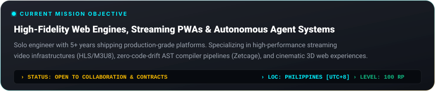
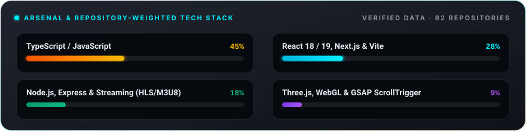

  <!-- GTA V HERO BANNER -->
  

    

  <!-- TITLE & WANTED LEVEL -->
  <h1>⚡ Z E T I C U Z</h1>
  
<strong>AI-First Full-Stack Engineer · Founder of TECHNOLOHIYA · Based in the Philippines 🇵🇭</strong>

  

    
    
    
  

  <!-- SKILL PILLS -->
  

    <code>⚡ React 18 / 19</code> &nbsp;
    <code>⚛️ TypeScript</code> &nbsp;
    <code>🎬 Streaming Engine (HLS/M3U8)</code> &nbsp;
    <code>🕹️ Three.js & WebGL</code> &nbsp;
    <code>🚀 Node.js Architecture</code> &nbsp;
    <code>🤖 Autonomous AI Agents</code>
  

---

### 🎯 Mission Objective

  

---

### ⚔️ Arsenal & Technology Breakdown

  

---

### 💼 Featured Operations & Production Heists

<table>
  <tr>
    <td width="50%" valign="top">
      <h3 style="margin-top:0;">⚡ <a href="https://github.com/ZETIC7Z/ZE-Uncage">Zetcage</a></h3>
      
High-performance Framer & no-code website cloner and AST compiler exporting to pristine <strong>Static HTML</strong> and <strong>React 18 + Vite (TSX/JSX)</strong> with 100% motion and physics fidelity.

      

        
        
        
      

    </td>
    <td width="50%" valign="top">
      <h3 style="margin-top:0;">🎬 <a href="https://github.com/ZETIC7Z/NEXUS-MOBILE-TV">NEXUS-MOBILE-TV</a></h3>
      
A free premium, ad-free streaming platform bringing thousands of movies and TV shows to your fingertips with intelligent subtitle controls, offline caching, and a Netflix-inspired UI.

      

        
        
        
      

    </td>
  </tr>
  <tr>
    <td width="50%" valign="top">
      <h3 style="margin-top:0;">🕹️ <a href="https://github.com/ZETIC7Z/Sam_Porfolio">Sam_Porfolio (zeticuz.xyz)</a></h3>
      
Interactive GTA V-inspired 3D web experience with sound fx, Three.js custom shaders, character illustrations, and GSAP ScrollTrigger timeline choreography.

      

        
        
        
      

    </td>
    <td width="50%" valign="top">
      <h3 style="margin-top:0;">🛡️ <a href="https://github.com/ZETIC7Z/sws-website">sws-website</a></h3>
      
SWS Skeptrons — Alpha Kappa Rho Chapter Website and dynamic digital Member ID Verification System with cryptographic validation and QR card generation.

      

        
        
        
      

    </td>
  </tr>
  <tr>
    <td width="50%" valign="top">
      <h3 style="margin-top:0;">📡 <a href="https://github.com/ZETIC7Z/ZETIANIME-API">ZETIANIME-API</a></h3>
      
High-throughput anime & media streaming aggregator API resolving playable stream links and metadata from multiple providers via a unified AniList ID.

      

        
        
        
      

    </td>
    <td width="50%" valign="top">
      <h3 style="margin-top:0;">🧠 <a href="https://github.com/ZETIC7Z/Skills">AI Agent Skills</a></h3>
      
Curated suite of production-grade agent skills for autonomous AI pair programming (Antigravity, Codex, Claude) covering 3D graphics, motion systems, and zero-drift pipelines.

      

        
        
      

    </td>
  </tr>
</table>

---

### 🌐 Connect & Communications

  
  &nbsp;
  
  &nbsp;
  
  &nbsp;
  
  &nbsp;
  

    

  

    <i>"Still Running, Not Hunting." · Built with passion by Sam (ZETICUZ)</i>
  

